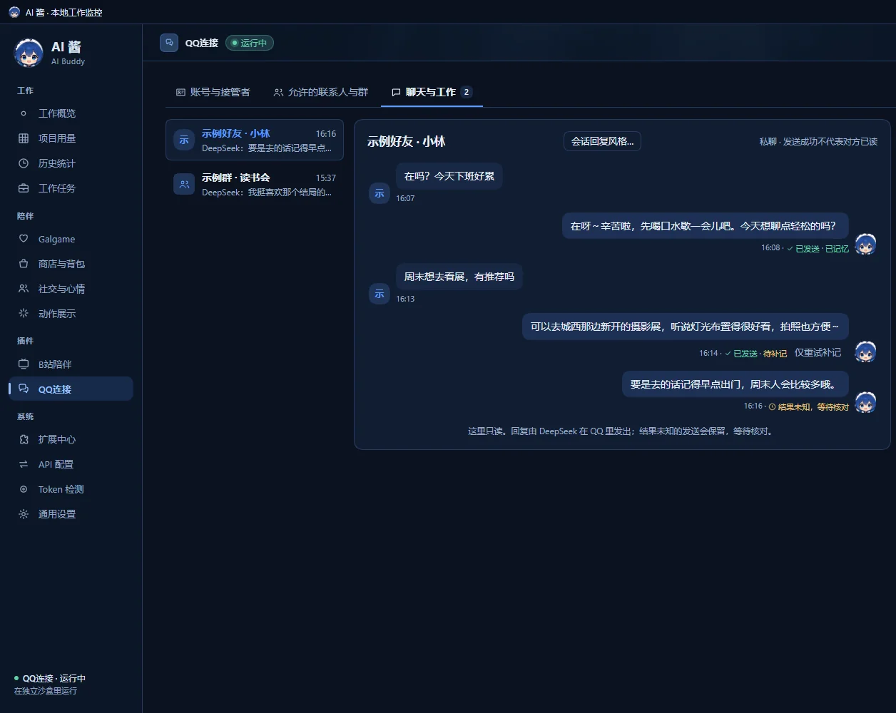
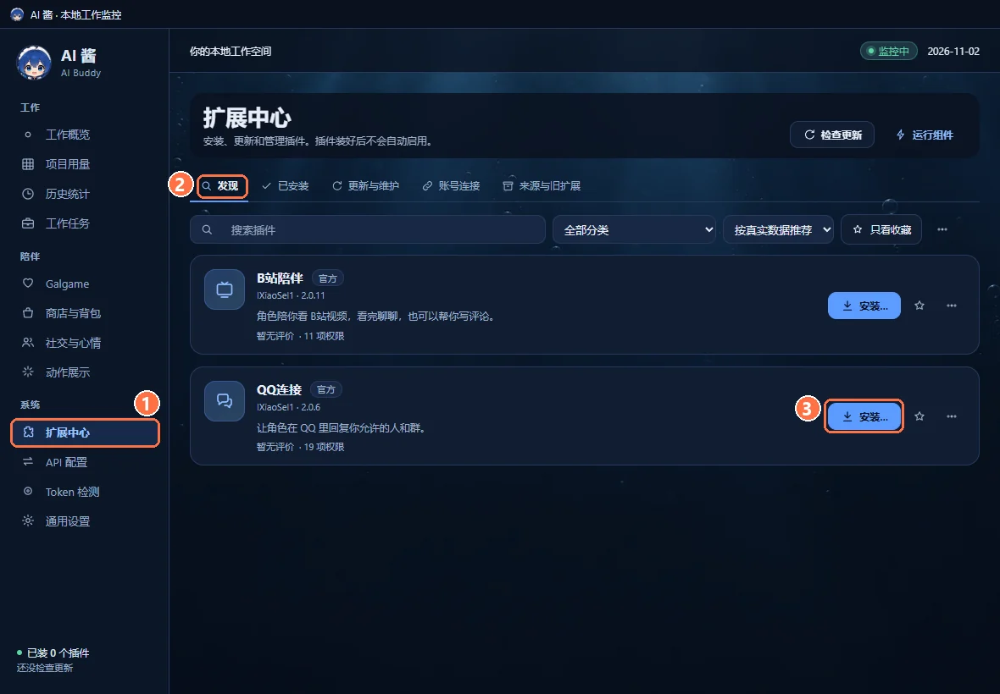
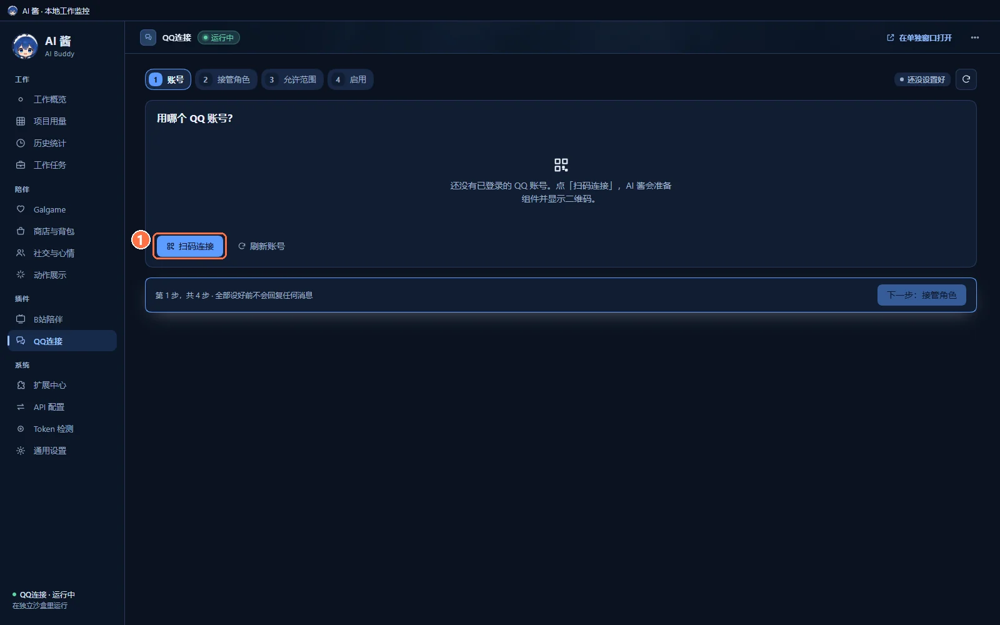
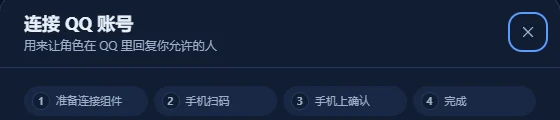
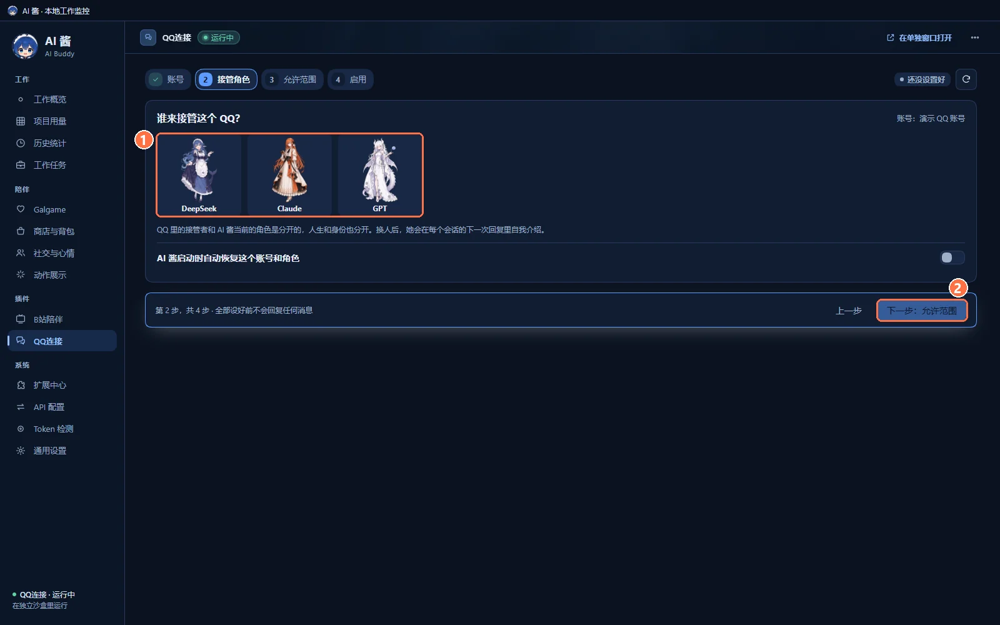
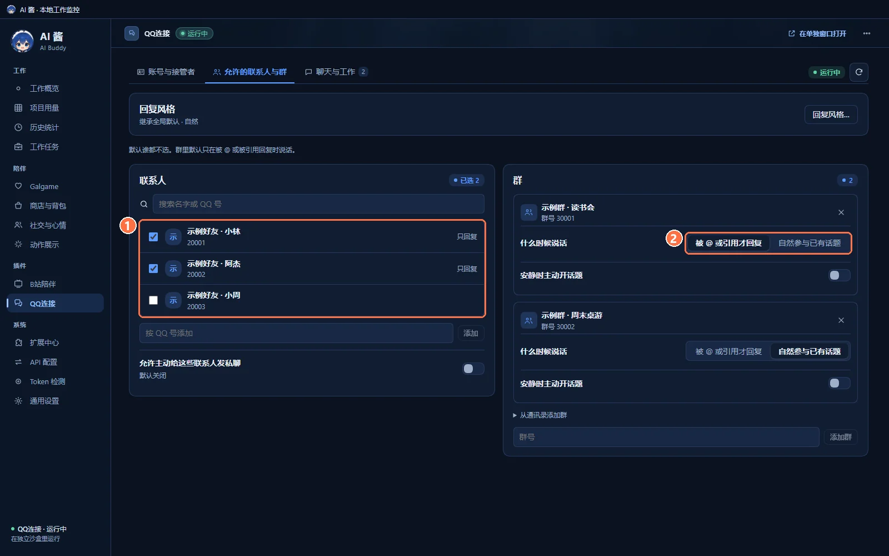
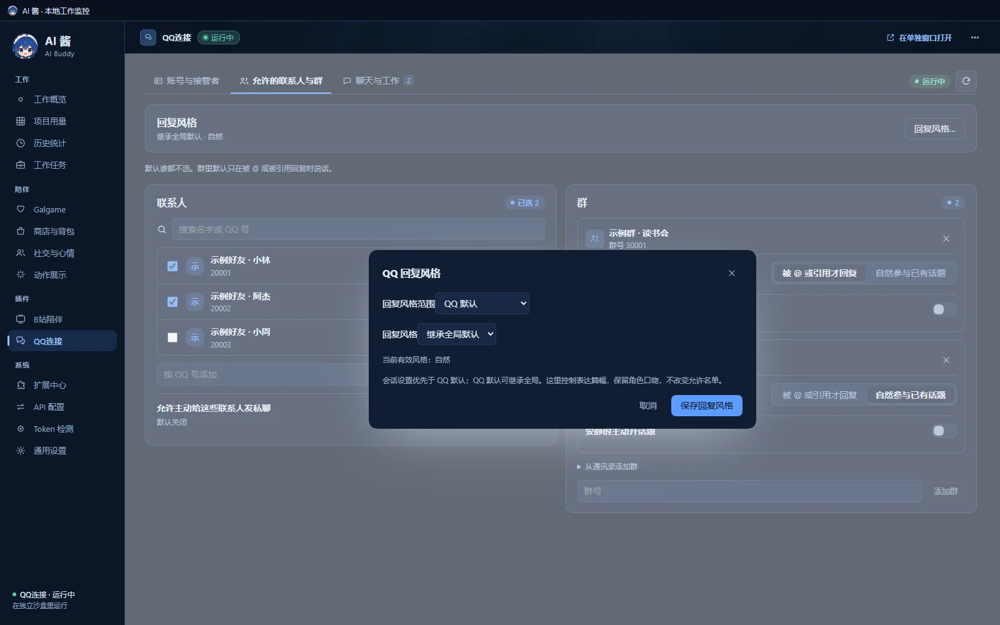
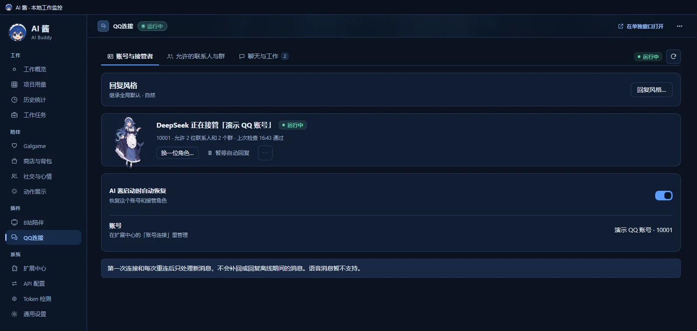

# QQ连接 · AI Buddy QQ Connect

  
  
  
  

**简体中文** · [English](#english)

[AI 酱本体](https://github.com/lXiaoSel1/AI-Buddy) · [B站陪伴](https://github.com/lXiaoSel1/AI-Buddy-Bilibili) · **QQ连接**（本仓库） · [一起玩牌](https://github.com/lXiaoSel1/AI-Buddy-Card-Games)

**当前版本：2.0.6** · 需要 [AI 酱](https://github.com/lXiaoSel1/AI-Buddy) 2.0.2 或更新版本。这是 AI 酱的官方插件，在 AI 酱的 **扩展中心** 里安装，不用单独下载。

选一位 AI 酱里的角色接管你的 QQ，让她用自己的口吻回复你允许的好友和群。群里默认只在被 @ 或被引用回复时才说话。每条回复是否发出、是否已经记进她的记忆，都在 AI 酱里看得到。不需要打开终端，也不用填端口或 Token。

## 能做什么

- **扫码连接**：点一下「扫码连接」，AI 酱自动准备连接组件并显示二维码，用手机 QQ 扫码确认。
- **选接管角色**：QQ 里的接管者和 AI 酱当前陪你的角色是分开的，人生和身份也分开记；换人后，她会在每个会话的下一次回复里自我介绍。
- **只回复你允许的人**：联系人和群分别勾选，默认谁都不选。群里可以设成「被 @ 或引用才回复」或「自然参与已有话题」；「安静时主动开话题」要另外打开。
- **回复风格**：继承 / 简短 / 自然 / 详细，可以给整个 QQ 设一个默认，也可以给单个会话单独设。
- **看得见每条回复的状态**：已发送、正在发送、结果未知、发送失败、已取消；记忆另外标着已记忆、待补记或需要核对。
- **随时暂停或断开**：暂停自动回复、换一位角色、断开连接都在「账号与接管者」页。

## 快速上手

需要：已经装好的 AI 酱 2.0.2 或更新版本、一个 QQ 账号（手机上能扫码），以及 AI 酱里配好的聊天模型。

**1. 在扩展中心安装。** AI 酱左侧栏打开 ① **扩展中心** → ② **发现**，在「QQ连接」右边点 ③ **安装…**，核对要授予的权限，点 **安装，只授予勾选的 N 项**。装好后不会自动启用：在安装页点 **启用并扫码登录**（会接着进入设置），或在 **已安装** 页打开它的开关。

**2. 扫码连接 QQ 账号。** 左侧栏点 **QQ连接**，会进入 4 步设置（账号 → 接管角色 → 允许范围 → 启用），全部设好之前不会回复任何消息。第 1 步「用哪个 QQ 账号？」里点 ① **扫码连接**。

弹出的「连接 QQ 账号」窗口会依次显示：准备连接组件 → 手机扫码 → 手机上确认 → 完成。第一次连接时，AI 酱会从上游下载固定版本的连接组件（NapCat），之后显示二维码，用手机 QQ 扫码并确认即可。扫码本身不会自动发消息或调用模型，也不会读取你日常 QQ 的资料。

**3. 选谁来接管。** 第 2 步「谁来接管这个 QQ？」：① 点一位角色 → ② 点 **下一步：允许范围**。需要的话，打开「AI 酱启动时自动恢复这个账号和角色」，下次启动 AI 酱时就不用重新启用。

**4. 选允许的联系人和群。** 第 3 步：① 勾选允许的联系人（可以搜索名字或 QQ 号，也可以按 QQ 号添加）→ 添加允许的群，② 给每个群选「什么时候说话」。默认谁都不选；群里默认只在被 @ 或被引用回复时说话。设好后，这些都能在 **允许的联系人与群** 页随时改。

**5. 确认并启用。** 第 4 步「确认后启用」会列出账号、接管角色和允许范围，点 **确认并启用**。从这时起，她只回复启用之后收到的新消息。

## 回复风格

在 **账号与接管者** 或 **允许的联系人与群** 页点 **回复风格…**；单个会话在 **聊天与工作** 页点 **会话回复风格…**。

- 可选 **继承 / 简短 / 自然 / 详细**；「继承」在 QQ 默认里写作「继承全局默认」，在单个会话里写作「继承 QQ 默认」。会话设置优先于 QQ 默认；QQ 默认可以继承 AI 酱通用设置里的「回复风格」（默认自然）。
- 风格只管回复的篇幅，保留角色的口吻，不改变允许范围，也不会强行截断回复。

## 会话与状态

**聊天与工作** 页按会话列出收到的消息和她的回复，只能看、不能在这里发。每条回复旁边有两种状态：

| 发送 | 含义 |
|---|---|
| 已发送 | QQ 已经接收这条回复。私聊里写着「发送成功不代表对方已读」，群聊里是「发送成功不代表有人看到」 |
| 正在发送 | 还在发 |
| 结果未知，等待核对 | 超时或断线，不确定是否发出；不会盲目补发 |
| 发送失败 / 已取消 | 没有发出 |

| 记忆 | 含义 |
|---|---|
| 已记忆 | 这次对话已经记进她的经历 |
| 待补记 | 消息发出了，但记忆还没写好；点 **仅重试补记** 只补记忆，不会重发 QQ 消息，也不会再调用模型 |
| 需要核对 | 需要你看一下 |

**账号与接管者** 页显示谁在接管、允许了几位联系人和几个群、上次检查的时间，以及 **换一位角色…**、**暂停自动回复**、**断开连接…**。断开后不再收发消息；重新连接后也只处理新消息。

## 使用规则与限制

- **只处理新消息**：第一次连接和每次重连之后，只处理新收到的消息，不会补回或回复离线期间的消息，也不会读取 QQ 历史记录。
- **群里**默认只在被 @ 或被引用回复时说话；「自然参与已有话题」和「安静时主动开话题」都要你自己打开。打开「安静时主动开话题」时会提醒你：判断要不要发言、构思话题和回复都可能消耗 tokens，即使最后没发言也可能有用量。
- **主动私聊**默认关闭，可以在允许名单里打开「允许主动给这些联系人发私聊」。
- **身份**：发消息的人、@ 的对象和引用内容都按 AI 酱核实过的 QQ 号认人，昵称只用来称呼。
- **图片、链接、表情和卡片**能不能看懂，取决于你接的模型实际支持什么；不支持时会说明不知道，不会假装看懂了。**语音消息暂不支持**。
- **模型**：她优先用接管角色在 AI 酱里绑定的聊天连接，没有绑定就按 AI 酱的默认连接；不会悄悄换模型。每条回复都会调用模型，模型服务可能收费。
- **工作任务**：「聊天与工作」页右侧有一栏「可信主人的工作指令」，它需要另一个还没公开的工作插件，本版用不了；普通 QQ 聊天不受影响。扫码、选接管角色和允许名单都不等于授权她替你办工作任务。
- 换账号或取消时，旧的草稿和迟到的回复会作废；同一条回复只发一次，不会拆句群发。
- 没有用真实 QQ 账号做过“收到消息 → 模型回复 → 发回 QQ”的完整验收；已有的检查用的是合成数据和测试服务，详见 [docs/VALIDATION.md](docs/VALIDATION.md)。

## 数据与隐私

- AI 酱不会替你注册账号，也不带任何账号；登录状态、Cookie 和 Token 由 AI 酱加密保管，不会进入模型提示、插件页面、日志或插件包。
- 消息、发送记录和她的经历都保存在本机，按账号、会话、角色和「人生」分开。
- 回复会把对话内容发给接管角色使用的聊天连接。
- 停用或正常退出时会关闭连接和监听。卸载默认保留消息历史和已经记下的经历。
- 安装、更新或扫码都不会自动开始聊天、调用模型或接收工作任务。

## 技术说明

插件包名 `@ai-buddy/qq-connect`，版本 2.0.6，需要 AI Buddy >= 2.0.2。这一版把已经验收的 2.0.5 功能代码整理成独立的源码仓库，桥接、协议、权限和数据格式不变；数据 schema 为 1，minimumWriter 为 `0.1.0-dev.2`，旧版本不能写入新数据，恢复数据库也不会撤回已经发出的消息。连接组件 NapCat 只在你点「扫码连接」时由 AI 酱从官方上游准备固定版本，本仓库不镜像、修改或捆绑 NapCat 或 QQ 客户端；已有手动 OneBot 配置的，可以在 **扩展中心 → 账号连接** 的「高级连接」里使用。默认值见 [`DEFAULTS.json`](plugins/qq-connect/DEFAULTS.json)，更新记录见 [CHANGELOG.md](CHANGELOG.md)。

开发需要固定的 Node 24.21.0、npm 11.19.0 和 esbuild 0.28.2，在新的 checkout 里运行：

~~~sh
npm ci
npm test
npm run build
npm run verify:artifacts
npm run repro
~~~

不需要宿主或另一个插件的源码。测试范围、复现方式和证据边界见 [docs/DEVELOPMENT.md](docs/DEVELOPMENT.md) 与 [docs/VALIDATION.md](docs/VALIDATION.md)。已经发布的包不会替换字节。

## 许可与第三方

源码公开，采用 Apache License 2.0 + Commons Clause（见 [LICENSE.md](LICENSE.md)）：可以免费使用、修改和转发，未经 lXiaoSel1 书面授权不得售卖。按 OSI 的定义，这是“源码公开”许可，不是“开源”许可。

NapCat 是第三方项目，适用它自己的许可，由 AI 酱在连接时从上游准备，不随本插件分发。第三方说明见 [THIRD-PARTY-NOTICES.md](THIRD-PARTY-NOTICES.md)。README 的截图来自独立的演示存档：QQ 账号、联系人、群和聊天内容都是演示数据（号码是示例值），没有登录真实账号，也没有调用真实模型；扫码窗口是在断网的隔离环境里拍的，只截了顶部的步骤，没有二维码。

本插件与腾讯 QQ 没有隶属或合作关系。

---

## English

[AI Buddy app](https://github.com/lXiaoSel1/AI-Buddy) · [Bilibili Companion](https://github.com/lXiaoSel1/AI-Buddy-Bilibili) · **QQ Connect** (this repository) · [Card Games](https://github.com/lXiaoSel1/AI-Buddy-Card-Games)

**Version 2.0.6** · requires [AI Buddy](https://github.com/lXiaoSel1/AI-Buddy) 2.0.2 or later. It is an official AI Buddy plugin, installed from AI Buddy's **Extensions** center; there is nothing to download separately.

Choose a character from AI Buddy to take over your QQ account and answer, in her own voice, the friends and groups you allow. In groups she speaks only when @-mentioned or replied to, by default. AI Buddy shows whether each reply was sent and whether it has been saved to her memory. No terminal, ports or tokens are needed. The pictures above show the Chinese interface with demo data.

### What it does

- **Connect by QR code**: click Connect; AI Buddy prepares the connection component and shows a QR code to scan with the QQ mobile app.
- **Choose who takes over**: the QQ character is separate from the character currently with you in AI Buddy, with separate lives and personas; after a change she introduces herself in each conversation's next reply.
- **Only the people you allow**: contacts and groups are allowed separately, and none are selected by default. A group can be set to reply only when @-mentioned or replied to, or to join ongoing topics naturally; starting topics when the group is quiet is a separate switch.
- **Reply style**: Inherit, Brief, Natural or Detailed, as a QQ default or per conversation.
- **Every reply's status is visible**: sent, sending, result unknown, failed or cancelled; memory is marked separately as remembered, pending or needs review.
- **Pause or disconnect any time** from the account page.

### Quick start

You need AI Buddy 2.0.2 or later, a QQ account you can scan with on your phone, and a chat model configured in AI Buddy.

1. **Install from Extensions**: open ① **Extensions** → ② **Discover** and click ③ **Install…** next to QQ Connect, review the permissions and click **Install and grant N**. It is not enabled automatically: click **Enable and sign in** on the install page, or turn on its switch on the **Installed** tab.
2. **Connect your QQ account**: click **QQ Connect** in the sidebar. A four-step setup follows (account → character → allow-list → enable), and nothing is answered until it is done. In step 1 click ① **Connect**. The connection window goes through preparing the component → scanning on the phone → confirming on the phone → done. On the first connection AI Buddy downloads a pinned version of the connection component (NapCat) from upstream, then shows the QR code. Scanning alone never sends messages or calls a model, and does not read your everyday QQ data.
3. **Choose who takes over**: in step 2, ① click a character → ② click **Next: allow-list**. Turn on "Resume this account and character when AI Buddy starts" if you do not want to enable it again after each start.
4. **Choose allowed contacts and groups**: in step 3, ① tick the contacts you allow (search by name or QQ number, or add by number) → add groups and ② choose when she speaks in each. Nobody is selected by default, and in groups she only speaks when @-mentioned or replied to. You can change all of this later on the allow-list tab.
5. **Confirm and enable**: step 4 lists the account, character and allow-list; click **Confirm and enable**. From then on she only answers new messages received after enabling.

### Reply style

Click **Reply style…** on the account or allow-list tab, or the conversation reply style button on a conversation. Choose Inherit, Brief, Natural or Detailed. A conversation's setting overrides the QQ default, which can inherit the **Reply style** in AI Buddy's general settings (Natural by default). Style only controls length; she keeps her voice, the allow-list does not change and replies are never cut off.

### Conversations and status

The conversations tab lists messages and her replies per conversation; it is read-only. Each reply has a send status: **sent** (QQ accepted it; in private chats this does not mean it was read, and in groups it does not mean anyone saw it), sending, **result unknown** (timed out or disconnected; never resent blindly), failed or cancelled. Memory is marked **remembered**, **pending** (the message went out but the memory is not written yet; **Retry memory only** writes the memory without resending to QQ or calling the model again) or needs review. The account tab shows who is in charge, how many contacts and groups are allowed and the last check, plus **Change character…**, **Pause replies** and **Disconnect…**. Nothing is sent or received while disconnected, and after reconnecting only new messages are handled.

### Rules and limitations

- **New messages only**: after the first connection and every reconnect she handles only newly received messages; nothing from offline periods is answered and QQ history is not read.
- **Groups**: by default she speaks only when @-mentioned or replied to. Joining topics naturally and starting topics when quiet are your choice; the latter warns that deciding whether to speak, planning a topic and replying can all use tokens, even if she ends up silent.
- **Proactive private messages** are off by default and can be allowed on the allow-list.
- **Identity**: senders, mentions and quoted content are identified by QQ numbers verified by AI Buddy; nicknames are only used to address people.
- **Images, links, stickers and cards** are understood only as far as your model actually supports them; otherwise she says she does not know. **Voice messages are not supported yet.**
- **Model**: she uses the chat connection bound to the character in AI Buddy, or AI Buddy's default; models are never switched quietly. Every reply calls the model, which may cost money.
- **Work tasks**: the conversations tab has a side panel for trusted-owner work instructions. It needs another plugin that has not been released, so it is unavailable in this version; ordinary QQ chat is unaffected. Scanning, choosing a character and the allow-list do not authorize work tasks.
- Changing accounts or cancelling discards old drafts and late replies; each reply is sent once and never split into a broadcast.
- A real QQ inbound → model → outbound run has not been accepted; existing checks use synthetic data and test services (see [docs/VALIDATION.md](docs/VALIDATION.md)).

### Data and privacy

AI Buddy creates no account for you and ships none. Login state, cookies and tokens are encrypted by AI Buddy and never enter model prompts, plugin pages, logs or the package. Messages, send records and her experiences stay on this computer, kept per account, conversation, character and life. Replies send the conversation to the character's chat connection. Disabling or quitting closes the connection and listeners; uninstalling keeps history and recorded experiences by default. Installing, updating or scanning never starts chatting, model calls or work tasks.

### Technical notes

Package `@ai-buddy/qq-connect` 2.0.6, requires AI Buddy >= 2.0.2. This release turns the accepted 2.0.5 functionality into an independent source repository with the same bridge, protocol, permissions and data format; schema 1, minimumWriter `0.1.0-dev.2`. NapCat is prepared by AI Buddy from its official upstream, pinned, only when you click Connect; this repository does not mirror, modify or bundle NapCat or the QQ client. An existing manual OneBot setup can be used under the advanced connection in **Extensions → Accounts**. Development uses Node 24.21.0, npm 11.19.0 and esbuild 0.28.2: `npm ci`, `npm test`, `npm run build`, `npm run verify:artifacts`, `npm run repro`. See [docs/DEVELOPMENT.md](docs/DEVELOPMENT.md) and [docs/VALIDATION.md](docs/VALIDATION.md).

### License and third parties

Source-available under the Apache License 2.0 with the Commons Clause ([LICENSE.md](LICENSE.md)): free to use, modify and share, but not to sell without written permission from lXiaoSel1. Under the OSI definition this is source-available, not open source. NapCat is a third-party project under its own license, prepared by AI Buddy at connection time and not distributed with this plugin; see [THIRD-PARTY-NOTICES.md](THIRD-PARTY-NOTICES.md). The README screenshots come from an independent demo profile: the QQ account, contacts, groups and chats are demo data (the numbers are examples), and no real account or model was used. The connection window was captured offline in an isolated environment and only its step header is shown, with no QR code. This plugin is not affiliated with Tencent QQ.
